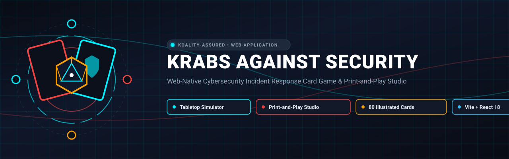
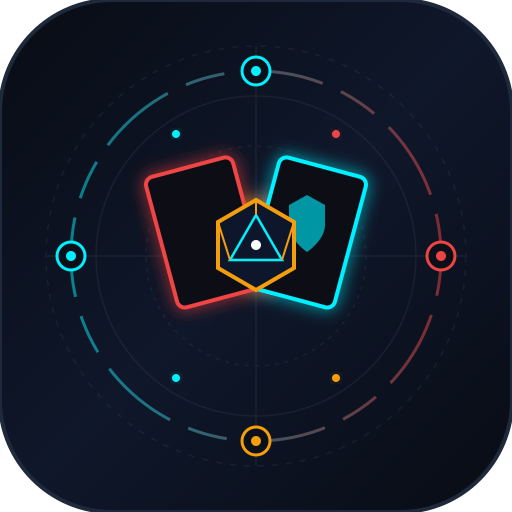

<div align="center">



# Krabs Against Security

<p align="center">
  
</p>

**Web-Native Cybersecurity Incident Response Card Game & Print-and-Play Studio**

[](https://github.com/Koality-Assured/krabs-against-security-web/actions/workflows/deploy.yml)
[](LICENSE)
[](https://nodejs.org/)
[](https://www.typescriptlang.org/)
[]()
[](https://conventionalcommits.org)

</div>

---

A web-native cybersecurity incident response tabletop card game and Print-and-Play (PnP) studio inspired by Black Hills Information Security's *Backdoors & Breaches* (CC BY-SA 4.0).
Defend the Krabby Patty Secret Formula in the Krusty Krab SOC against **APT-Chum (Plankton)**!
Live Production Endpoint: **[https://krabs.ketron.dev](https://krabs.ketron.dev)**  
Vanity Aliases: `https://kas.ketron.dev` &bull; `https://krabsagainstsecurity.ketron.dev`
---
## Features
### 1. Tier 0 Procedural CSS/SVG Card Renderer (`Card.tsx`)
- Zero-image requirement: Fully playable and printable with pure CSS and vector SVGs immediately.
- Color-coded borders matching canonical deck types with corner brass rivets:
  - **Initial Compromise** (Crimson / Red)
  - **Pivot & Escalate** (Amber / Yellow)
  - **Persistence** (Violet / Purple)
  - **C2 & Exfiltration** (Bronze / Brown)
  - **Defensive Procedures** (Ocean Blue)
  - **Operational Injects** (Kelp Green / Slate)
- Nautical vector iconography (anchors, hooks, radar, clams, skulls, terminals, shields).
- Bold maritime serif titles, crisp monospace mechanics box, d20 check badges, and MITRE ATT&CK technique tags.
- Dynamic asset hydration: Automatically loads raster art from `assets/cards/` if present, falling back gracefully without layout breakage or console errors.
### 2. Print-and-Play Studio (`PrintStudio.tsx`)
- **3x3 Grid Layout**: Formatted for standard consumer printing (9 cards per sheet) on both **US Letter** ($8.5'' \times 11''$) and **ISO A4** ($210 \times 297\text{ mm}$).
- **Automated Duplex Column Mirroring**: Automatically reverses horizontal columns on back sheets (`[C1, C2, C3]` &harr; `[C3, C2, C1]`) to guarantee 100% front/back registration when printing double-sided on long-edge flip printers.
- **2x3 Gutter-Fold Craft Template**: Side-by-side front and back layout along a center fold seam for manual fold-and-glue construction on 110lb cardstock.
- **Eco-Print Mode Toggle**: High-contrast monochrome line art eliminating background fills, saving $>75\%$ printer toner/ink.
- **Crop Marks & Cut Guides**: Millimeter-calibrated cutting guides and crosshair crop marks.
- **Programmatic Client-Side PDF Generation (`pdf-lib`)**: Generates calibrated 300 DPI vector PDFs directly in the browser with zero server roundtrip.
- **Export Single Cards (ZIP)**: Packages all cards into standalone SVG and JSON metadata files for Roll20, Tabletop Simulator, or digital printing.
### 3. Interactive Incident Tabletop Board (`TabletopBoard.tsx`)
- **4 Secret Scenario Slots**: Initial Compromise, Pivot & Escalate, Persistence, and C2 & Exfiltration dealt face-down.
- **Card Flip Animations**: Smoothly reveals attack telemetry and technical IOCs upon successful investigation checks.
- **Strike Doom Tracker**: Visual progression (1 to 10 Krabby Patty strikes) with automatic inject detonations on strikes 2, 4, 6, and 8.
- **Facilitator Secret View Toggle**: Enables private peeking at face-down cards during facilitator-led exercises without spoiling the board for defenders.
- **Incident Audit Log**: Real-time chronological telemetry log recording checks, strikes, and contained phases.
### 4. Animated Crustacean d20 Dice Roller (`DiceRoller.tsx`)
- 3D facet animated twenty-sided die with realistic roll physics.
- Automatic Margin-of-Success calculation: $\text{Roll} + \text{Modifiers} = \text{Total vs. Target Check}$.
- **Web Audio API Procedural Sound Engine**: Synthesized dice rolling rattles, cash register ka-ching / fanfare on Natural 20, sad foghorn on Natural 1, and strike alarm klaxons.
### 5. Canonical 80-Card Catalog (`src/data/cards.json`)
- **12 Initial Compromise cards** (MITRE ATT&CK mapped: T1566.001, T1190, T1091, T1200, T1195.002, etc.)
- **12 Pivot & Escalate cards** (Pass the Hash, LOLBins, SITM, Unquoted Service Paths, Kerberoasting, etc.)
- **12 Persistence cards** (Registry Run Keys, PHP Web Shells, Cron Jobs, UEFI Firmware, Golden Tickets, etc.)
- **12 C2 & Exfiltration cards** (DNS Tunneling, S3 Buckets, Ransomware, Steganography, ICMP Exfil, etc.)
- **16 Defensive Procedures** (Endpoint Memory Forensics, Zeek Packet Inspection, SIEM Log Analysis, Host Quarantine, etc.)
- **16 Operational Injects** (Squidward's Shift Ended, Mr. Krabs Screams About Electric Bill, Spongebob Fiber Sever, etc.)
---
## Technology Stack
- **Framework**: React 18 + TypeScript + Vite
- **Styling**: Tailwind CSS
- **Vector Icons**: Lucide React + Custom SVG Glyphs
- **PDF Engine**: `pdf-lib` (Client-side vector PDF composition)
- **Archive Engine**: `jszip` (Single card SVG bundle export)
- **Celebration Effects**: `canvas-confetti`
- **Audio Engine**: Procedural Web Audio API sound synthesis
---
## Getting Started
### Prerequisites
- Node.js 18+ or 20+
- npm or pnpm
### Installation
```bash
# Clone the repository
git clone https://github.com/Koality-Assured/krabs-against-security-web.git
cd krabs-against-security-web
# Install dependencies
npm install
# Start development server
npm run dev
```
### Production Build
```bash
# Compile TypeScript and bundle with Vite into dist/
npm run build
# Preview production build locally
npm run preview
```
---
## Cloudflare Pages Deployment
The client is configured for zero-configuration continuous deployment on **Cloudflare Pages**:
- **Build Command**: `npm run build`
- **Build Output Directory**: `dist`
- **Production Domain**: `krabs.ketron.dev`
- **Edge Security Headers (`public/_headers`)**:
  - HTTP Strict Transport Security (HSTS): `max-age=31536000; includeSubDomains; preload`
  - Hardened Content Security Policy (CSP)
  - `X-Frame-Options: SAMEORIGIN` and `X-Content-Type-Options: nosniff`
  - Immutable 1-year caching for `/assets/*`
- **Edge Routing (`public/_redirects`)**:
  - SPA Fallback routing: `/* /index.html 200`
  - Canonical 301 vanity redirects: `kas.ketron.dev/*` & `krabsagainstsecurity.ketron.dev/*` &rarr; `krabs.ketron.dev/:splat`
---
## Legal & Intellectual Property Notice
- **Backdoors & Breaches Attribution**: *Krabs Against Security* is an educational parody based on *Backdoors & Breaches* by **Black Hills Information Security (BHIS)**, licensed under **Creative Commons Attribution-ShareAlike 4.0 International (CC BY-SA 4.0)**.
- **Parody Fair Use**: Krabs Against Security is an independent educational training project. It is not affiliated with, sponsored by, or endorsed by Nickelodeon, Paramount Global, or ViacomCBS. All character references and undersea corporate tropes represent satirical parody commentary protected under U.S. copyright and trademark fair-use doctrine.
- **Code License**: The web client software and PDF generator engine are released under the [MIT License](LICENSE).
